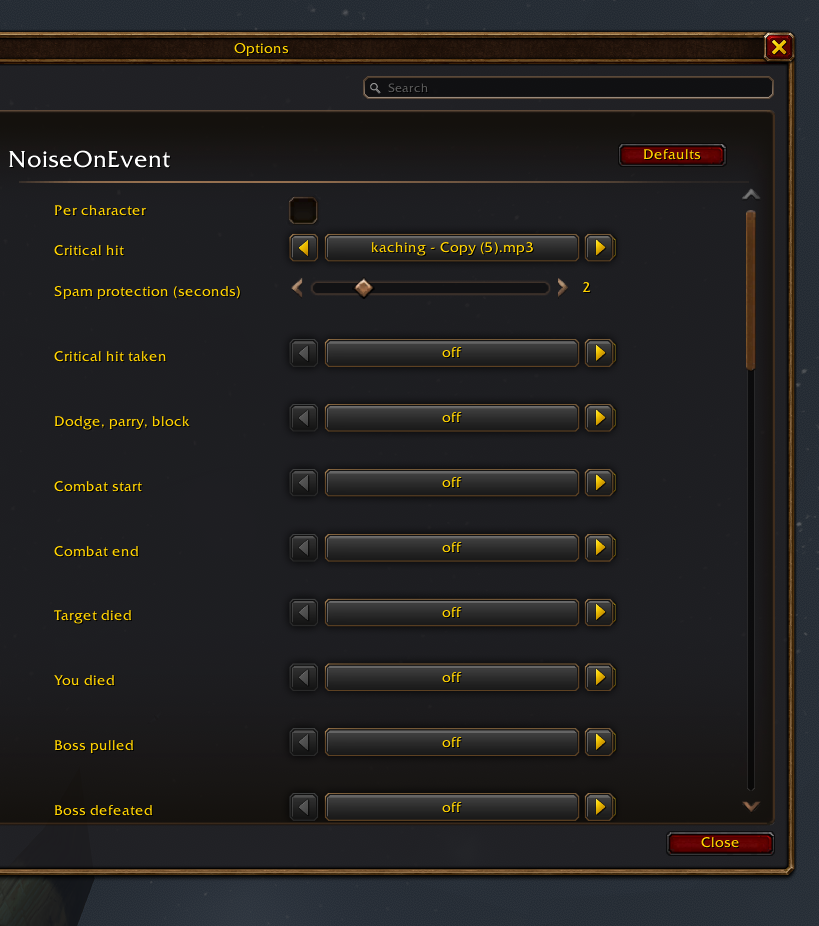

# NoiseOnEvent

Plays your own sound files on game events: pick a sound per event from a dropdown. Where
the game has its own sound for an event, yours replaces it, or you switch it off.

## Features

- **Combat** - critical hit on your target (from anyone; the game hides the source of a
  hit from addons) with a spam protection of 0-10 seconds (default 1), critical hit taken,
  dodge/parry/block, combat start and end, target died, you died, boss pulled, boss
  defeated.
- **Gathering and loot** - herb gathered, ore mined, skinned, fish caught, disenchanted,
  rare or better item looted, money received, auction sold.
- **Group and social** - ready check, dungeon finder ready, PvP queue ready, group invite,
  whisper; each can keep the game sound, use yours, or be off. Ready check, dungeon finder,
  and PvP queue share one game sound: replacing it for one also silences it for the others.
- **Progress** - level up, achievement, quest turned in (game sound, yours, or off), new
  mail, gear damaged below an average durability threshold (5-100 %, default 20), bags
  full, rare or treasure on the minimap.
- **Pings** - one sound per ping type (attack, warning, assist, on my way, threat, look
  here, spell or item ping), the game sound, or off.
- **Own sounds** - any `.mp3` or `.ogg` files in the addon's `sounds` folder, listed in
  game with `/noise add`; the list is saved and survives updates; a missing file gets one
  warning in chat.
- **Remembered** - settings are saved per account, or per character with one checkbox;
  no event plays a sound until you pick one.
- **Settings page** - one dropdown per event in the game menu under Options > AddOns,
  grouped under headers, also opened from the addon compartment menu.
- **Chat commands** - every option can also be changed by slash command; `/noise test`
  plays an event's sound.

## Screenshots



## Install

1. Download `NoiseOnEvent-vX.Y.Z.zip` from the [releases](https://github.com/tf4482/NoiseOnEvent/releases) or
   [CurseForge](https://www.curseforge.com/projects/1827447).
2. Unzip it into `World of Warcraft/_forever_/Interface/AddOns/`.
3. Create the folder `Interface/AddOns/NoiseOnEvent/sounds/` and copy your `.mp3` or
   `.ogg` files into it.
4. Restart the game (new files are only found after a restart), list each file once with
   `/noise add <file>`, type `/reload`, then pick a sound per event under
   Options > AddOns > NoiseOnEvent.

Back up the `sounds` folder before updating; an update replaces the addon folder. The
list itself is saved and stays.

### Optional: list all files automatically (Windows)

Instead of `/noise add` per file, create your own script once. Save this as
`update-sounds.bat` in the `sounds` folder and double-click it after adding files; it
writes every `.mp3` and `.ogg` file into `Sounds.lua`, which the addon merges into its
list on the next game start:

```bat
@echo off
rem write every .mp3 and .ogg file in this folder into Sounds.lua
cd /d "%~dp0"
chcp 65001 >nul
> Sounds.lua (
  echo local _, ns = ...
  echo ns.sounds = {
  for %%F in (*.mp3 *.ogg) do echo   "%%F",
  echo }
)
echo [OK] Sounds.lua written - restart the game
pause
```

Run it again after every addon update, since the update removes the folder.

## Usage

```text
/noise                            show all events with a chosen sound
/noise <event> <sound>|off        sound for an event, or off
/noise <event> game               game sound again (events with a game sound)
/noise critdelay <seconds>        spam protection for critical hits, 0 to 10
/noise durabilitylimit <percent>  durability threshold for gear damaged, 5 to 100
/noise test <event>               play the sound chosen for an event
/noise add <file>                 list a sound file from the sounds folder
/noise remove <file>              remove a sound file from the list
/noise sounds                     show the listed sound files
/noise character on|off           use settings for this character only, or the account's
/noise reset                      reset the settings to defaults; the sound list stays
/noise debug on|off               show what the addon does, until /reload
/noise config                     open the settings page
/noise help                       list all commands
```

`<sound>` is a listed file name (`/noise sounds`); put names with spaces in quotes.
`<event>` is one of:

| Group | Events |
| --- | --- |
| Combat | `crit`, `crittaken`, `avoid`, `combatstart`, `combatend`, `targetdied`, `death`, `bosspull`, `bosskill` |
| Gathering and loot | `herb`, `mining`, `skinning`, `fishing`, `disenchant`, `loot`, `money`, `auction` |
| Group and social | `readycheck`, `lfg`, `pvp`, `invite`, `whisper` |
| Progress | `levelup`, `achievement`, `quest`, `mail`, `durability`, `bagsfull`, `rare` |
| Pings | `attack`, `warning`, `assist`, `onmyway`, `threat`, `nonthreat` (also all pings in instance combat), `action` |

## Examples

- Add a new sound: copy `horn.ogg` into the `sounds` folder, restart the game, then
  `/noise add horn.ogg` (it plays once as a check).
- Kaching on every critical hit: `/noise crit kaching.mp3`.
- Crits in AoE fights get noisy: `/noise critdelay 5` plays at most one crit sound every
  5 seconds.
- Try a sound before playing: pick it in the dropdown, then type `/noise test mining`.
- Never miss a dungeon pop: `/noise lfg horn.ogg`.
- Quiet whispers while streaming: `/noise whisper off`.
- Repair reminder at half durability: `/noise durabilitylimit 50`, then
  `/noise durability bell.ogg`.
- Back to the game's attack ping: `/noise attack game` (unmutes it right away).
- Silence spell and item pings completely: `/noise action off`.
- A horn only for warnings: `/noise warning horn.ogg`, the other pings keep the game sound.
- Your gathering alt should hear herbs, your main not: on the alt type
  `/noise character on`, then `/noise herb bell.ogg`.
- Check what is set: `/noise`.

## Develop

Check the code with [Luacheck](https://github.com/lunarmodules/luacheck) before each commit
(CI runs it on every push):

```text
luacheck .
```

Deploy locally: run `deploy.bat`; it builds `release/NoiseOnEvent-vX.Y.Z.zip` from `VERSION`.

Release: set `VERSION` to `X.Y.Z`, then push an annotated tag `vX.Y.Z`; GitHub Actions
packages the addon with the BigWigs packager and publishes it.

## License

All rights reserved, see [LICENSE](LICENSE).
